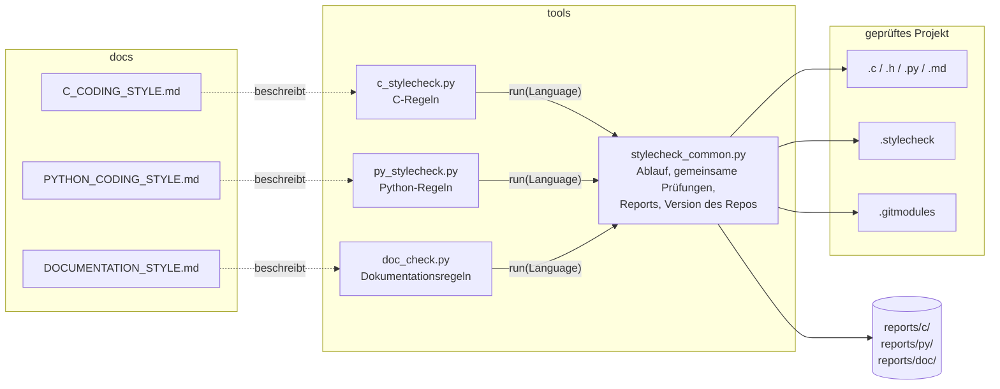
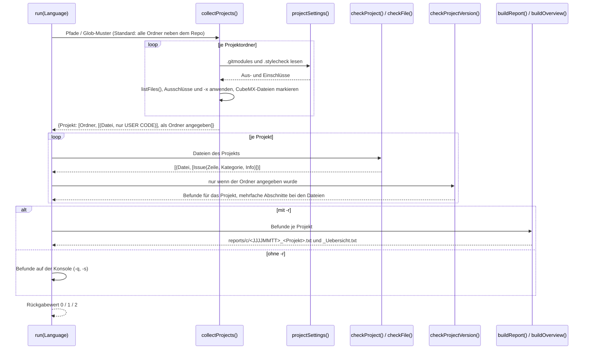

# Architektur Coding_Styleguide

Das Repository besteht aus den Regeln (`docs/*_STYLE.md`) und drei Prüfern in `tools/`, die Quelldateien und Dokumentation in den Nachbar-Repos gegen diese Regeln prüfen. Alle Prüfer laufen nach demselben Ablauf: Projekte finden, jede Datei prüfen, Befunde sammeln, ausgeben oder als Report schreiben. Dieser Ablauf und alles, was mehrere Prüfer gleich prüfen, liegt in `stylecheck_common.py`. Die Prüfer enthalten nur ihre eigenen Regeln.

## Komponenten

| Modul | Datei(en) | Aufgabe |
|-------|-----------|---------|
| Gemeinsamer Code | `tools/stylecheck_common.py` | `run()` mit Kommandozeile, Projektsuche (`collectProjects`, `projectSettings`), Ausgabe, Reports und Übersicht. Gemeinsame Prüfungen: Zeilenenden (`readLines`), Kopfblock (`checkHead`), Abschnittsform, Pflicht- und Variablen-Abschnitte, Debug-Abschnitt, Reihenfolge (`checkOrder`) und Version je Projekt (`checkProjectVersion`). Enthält den Abschnitt `Version definieren` des Repositories |
| C-Prüfer | `tools/c_stylecheck.py` | Prüft `.c`/`.h` zeilenweise mit regulären Ausdrücken (Header, Formatierung, `switch`/`case`, Ausrichtung). Erkennt von STM32CubeMX erzeugte Dateien und prüft dort nur die `USER CODE`-Bereiche |
| Python-Prüfer | `tools/py_stylecheck.py` | Prüft `.py` mit `ast` (Imports, Funktionen, Klassen, Abschnitte) und `tokenize` (Kommentare, Strings, Anweisungen) |
| Dokumentations-Prüfer | `tools/doc_check.py` | Prüft je Projekt die Pflichtdokumente der Repo-Klasse, Dokumente aus `[doc] require`, Ablage und Ordner-READMEs (`checkWhole`) und je `.md` relative Links und den Abschnitt `## Lizenz` (`checkFile`) |
| Regeln | `docs/C_CODING_STYLE.md`, `docs/PYTHON_CODING_STYLE.md`, `docs/DOCUMENTATION_STYLE.md` | Maßgebliche Beschreibung. Der Prüfer setzt um, was dort steht, nicht umgekehrt |
| Projekteinstellungen | `.stylecheck` im geprüften Projekt | Zusätzliche Aus- und Einschlüsse, `[stylecheck]` für alle Prüfer, `[c]`, `[py]` und `[doc]` je Prüfer. `[doc]` enthält außerdem Repo-Klasse und verlangte Dokumente |

Jeder Prüfer beschreibt seine Sprache mit einem `Language`-Objekt: Name, Regeldatei, Dateiendungen, Zeile des Versionsabschnitts (`None` = keine Versionsprüfung), automatische Ausschlüsse, eine Funktion `checkProject`, die alle Dateien eines Projekts prüft, und optional `isGenerated` für erzeugte Dateien, `checkWhole` für Befunde zum ganzen Projekt, `allDirs` (jeder Ordner ist ein Projekt, auch ohne passende Dateien) und `configKeys` (erlaubte Einträge im eigenen Abschnitt der `.stylecheck`).

## Datenfluss

Ablauf eines Aufrufs, am Beispiel `py tools/c_stylecheck.py -r`. `py_stylecheck.py` läuft genauso, nur mit eigenem `checkProject`. `doc_check.py` ruft statt `checkProjectVersion()` sein `checkWhole()` auf.

- Ein Befund ist immer ein `Issue` mit Zeile (`0` = ganze Datei bzw. ganzes Projekt), Kategorie und Zusatzinfo. Ausgabe, Report und Übersicht arbeiten nur mit diesen Listen.
- Reports werden als ASCII mit CRLF geschrieben. Ein Report vom selben Tag wird überschrieben.

## Erweiterung

- **Neue Prüfung für eine Sprache:** in `checkFile()` des passenden Prüfers mit `add(zeile, "Kategorie", "Info")` einen Befund melden. Gilt sie für beide Sprachen, gehört sie als Funktion nach `stylecheck_common.py`. Die Regel steht vorher im zugehörigen `docs/*_STYLE.md`.
- **Neue Einstellung in `.stylecheck`:** in `projectSettings()` auswerten. Unbekannte Abschnitte und Einträge erzeugen dort eine Warnung, ein neuer Abschnitt muss deshalb in `CONFIG_SECTIONS` eingetragen werden. Eigene Einträge eines Prüfers stehen in `configKeys` seines `Language`-Objekts (z. B. `class` und `require` in `[doc]`).
- **Neue Dokumentationsprüfung:** Betrifft sie eine einzelne `.md`, gehört sie in `checkFile()` von `doc_check.py`, betrifft sie das ganze Projekt, in `checkWhole()`. Die geplanten Gliederungsprüfungen für README, CHANGELOG, ARCHITECTURE und RUNBOOK kommen als eigene Funktionen dazu, die `checkFile()` je nach Dateiname aufruft.
- **Neuer Prüfer:** ein `Language`-Objekt mit eigenem `key` (Abschnitt in `.stylecheck` und Report-Unterordner) und eigenem `checkProject` anlegen und `run()` aufrufen. Optionen, Reports und Übersicht kommen damit automatisch.
- **Version:** Das Repository hat nach `docs/DOCUMENTATION_STYLE.md` Abschnitt 6 genau eine Version. Sie steht im Abschnitt `Version definieren` von `stylecheck_common.py` (`STYLECHECK_COMMON_*`).
