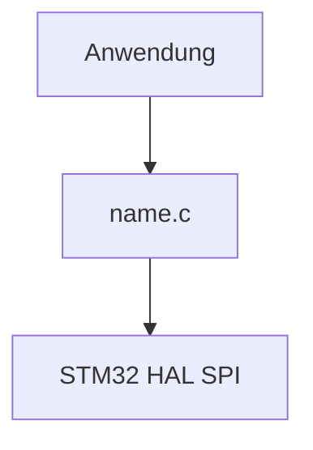
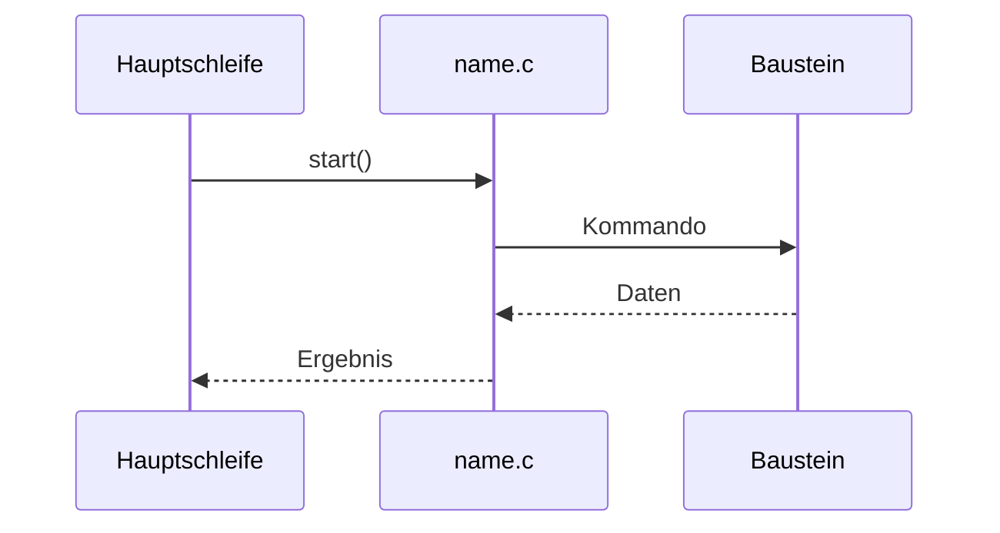

# Documentation Style

Verbindliche Regeln für die Dokumentation in den Repositories von **Diveturtle93**: welche Dokumente ein Repository braucht und wie sie aufgebaut sind.

Jedes Repository hat eine README und einen CHANGELOG. Was in der README steht, hängt von der Repo-Klasse ab. ARCHITECTURE, RUNBOOK, ADRs und Ordner-READMEs kommen nur hinzu, wenn die Kriterien in Abschnitt 3 zutreffen. CONTRIBUTING, SECURITY und CODE_OF_CONDUCT entfallen.

---

## 1. Allgemeine Regeln

| Regel | Festlegung |
|---|---|
| Sprache | Deutsch, Code-Bezeichner und Dateinamen bleiben, wie sie sind |
| Zeichensatz | UTF-8, Umlaute sind erlaubt (anders als im Code) |
| Format | Markdown (`.md`) |
| Diagramme | Mermaid direkt im Markdown, damit GitHub sie rendert und sie mit dem Code versioniert werden |
| Bilder | `.gif` / `.png` nur, wenn Mermaid nicht reicht, abgelegt in `docs/img/` |
| Ergänzende Dokumente | in `docs/`, Beispielcode in `examples/` |
| Änderungen | Wird eine Schnittstelle geändert, werden README und CHANGELOG im selben Commit angepasst |

Im Hauptverzeichnis liegen nur README, CHANGELOG, LICENSE, ARCHITECTURE und RUNBOOK. Fachdokumente wie `ADC.md`, `CAN.md` oder `INPUTS.md` liegen in `docs/`. Die README verlinkt sie im Abschnitt `## Dokumente` mit einer Tabelle `Dokument | Inhalt`.

---

## 2. Repo-Klassen

Jedes Repository gehört zu genau einer Klasse. Die Klasse bestimmt den Mittelteil der README (Abschnitt 4.2). Anfang (Titel, Beschreibung) und Ende (Abhängigkeiten, Lizenz) sind in allen Klassen gleich.

| Klasse | Repositories | Kennzeichen |
|---|---|---|
| Bibliothek | alle `STM32_*`, `IMD_IR155_3204` | wird in andere Projekte eingebunden, meist als Submodul |
| Firmware-Anwendung | `EAuto_BMS`, `EAuto_Motor`, `EAuto_Bootloader`, `STM32F7_Blinky`, `STM32F7_MicroBoot` | läuft auf einer Platine, bindet Bibliotheken ein |
| PC-Werkzeug | `EAuto_Dashboard` | wird auf dem PC installiert und bedient |
| Referenz | `CAN_Matrix`, `Coding_Styleguide` | Festlegungen, die für mehrere Projekte gelten |
| ausgenommen | `APP`, `Diveturtle93` (GitHub-Profil) | keine Pflichtdokumente, wird nicht geprüft |

---

## 3. Wann welches Dokument

Ein Dokument wird Pflicht, sobald mindestens ein Kriterium zutrifft. Die Zeilenzahl dient nur als Anhaltspunkt. Entscheidend ist, ob man den Aufbau ohne Erklärung aus dem Code versteht.

| Dokument | Pflicht, wenn … | Ablage | Betrifft heute |
|---|---|---|---|
| `README.md` | immer | Hauptverzeichnis | alle Repos außer den ausgenommenen |
| `CHANGELOG.md` | immer, ab dem ersten Tag `1.0.0` | Hauptverzeichnis | alle Repos außer den ausgenommenen |
| `LICENSE` | keine Pflicht; liegt sie vor, ist `## Lizenz` in der README Pflicht | Hauptverzeichnis | fehlt in `CAN_Matrix` |
| `ARCHITECTURE.md` | ≥ 3 zusammenspielende Module oder Schichten; ein Datenfluss über mehrere Stufen (ISR → Puffer → Verarbeitung); Speicher- oder Flash-Aufteilung; mehrere Teilsysteme (z. B. Firmware + PC-Tool); Richtwert > 1000 Zeilen | Hauptverzeichnis | `STM32_LTC6811`, `STM32_Shell`, `STM32_BootloaderXModem`, `STM32_Logging`, `EAuto_BMS` |
| `RUNBOOK.md` | Am Gerät wird etwas ausgeführt, das schiefgehen kann: Firmware-Update, Inbetriebnahme, Kalibrierung, Wiederherstellung. Liegt in der Anwendung oder im Werkzeug, nicht in der Bibliothek | Hauptverzeichnis | `EAuto_Bootloader`, `EAuto_Dashboard` (vorhanden); `EAuto_BMS` prüfen |
| `docs/adr/` | Das Projekt hat eine ARCHITECTURE **und** Entscheidungen, die sich schwer zurücknehmen lassen: Speicherformat, Protokoll, Speicherlayout, Hardwarewahl | `docs/adr/NNNN-titel.md` | `STM32_Logging` |
| Ordner-README | Ordner mit mehreren ausführbaren Werkzeugen oder mehr als 3 Dokumenten | im Ordner selbst | `Coding_Styleguide/tools`; `docs/` von `EAuto_BMS` und `EAuto_Motor` nach dem Verschieben |

---

## 4. README

Die Gliederung übernimmt die Reihenfolge, die in den bestehenden READMEs schon üblich ist (z. B. `STM32_AD8403`, `STM32_DataWatchpointTrigger`, `STM32_Canbus`). Pflichtabschnitte stehen in jeder README. Optionale Abschnitte kommen nur dazu, wenn es etwas zu sagen gibt, und zwar an der angegebenen Stelle.

### 4.1 Bibliothek

| # | Abschnitt | Pflicht | Inhalt und Form |
|---|---|---|---|
| 1 | `# STM32 <Name>` + Einleitung | ja | Titel ohne Unterstrich. 2–4 Sätze darunter: was die Bibliothek ist, welcher Baustein bzw. welche Funktion, welche Schnittstelle (SPI, UART, CAN …) |
| 2 | `## Beschreibung` | ja | Funktionsweise und Hintergrund zum Baustein oder Verfahren, wenn nötig mit Aufzählung der Besonderheiten |
| 3 | `## Funktionsumfang` | optional | Aufzählung der Features bei Modulen mit vielen Funktionen (Shell, Systeminfo) |
| 4 | `## Dateien` | ja | Tabelle `Datei` / `Beschreibung`, eine Zeile pro `.c`/`.h`-Datei |
| 5 | `## Hardware-Konfiguration` / `## Konfigurationsparameter` | optional | CubeMX-Einstellungen, Pinbelegung, Timer/DMA und `#define`-Parameter, jeweils als Tabelle |
| 6 | Fachliche Abschnitte | optional | z. B. Adressierung, Datentypen, Protokoll, Zustände. Tabellen für Werte, Mermaid für Abläufe und Zustände |
| 7 | `## API` | ja | Ein `c`-Codeblock mit allen öffentlichen Funktionen, je Zeile ein kurzer Kommentar. Bei vielen Funktionen mit `###` gruppieren, Details unter `### Funktionsdetails` |
| 8 | `## Verwendung` | ja | Nummerierte Schritte `### 1. Dateien einbinden`, `### 2. … initialisieren`, `### 3. …` mit je einem kurzen Codebeispiel |
| 9 | `## Hinweise` | optional | Fallstricke, Voraussetzungen und Projekte, in denen die Bibliothek eingesetzt wird (mit Link) |
| 10 | `## Unterstützte …` | optional | Cortex-M-Kerne bzw. STM32-Familien, wenn die Bibliothek nicht überall läuft |
| 11 | `## Quellen` | optional | Datenblätter, Vorbilder, Protokollspezifikationen als Links |
| 12 | `## Abhängigkeiten` | ja | Aufzählung `` `header.h` – Zweck ``. Eigene Bibliotheken werden auf ihr Repository verlinkt |
| 13 | `## Lizenz` | wenn `LICENSE` vorhanden | Lizenz aus der `LICENSE` nennen und verlinken: „Dieses Projekt steht unter der [<Lizenz>](LICENSE).“ Bei den `STM32_*`-Projekten ist das die GPL-3.0. Ohne `LICENSE` entfällt der Abschnitt |

Vorlage:

````markdown
# STM32 <Name>

Eine in C implementierte Bibliothek für <Baustein/Funktion> auf STM32-Mikrocontrollern.
Die Ansteuerung erfolgt über <Schnittstelle>.

## Beschreibung

<Funktionsweise, Hintergrund>

## Dateien

| Datei    | Beschreibung      |
|----------|-------------------|
| `name.h` | Definitionen, API |
| `name.c` | Implementierung   |

## API

```c
void initName (void);    // Kurzbeschreibung
```

## Verwendung

### 1. Dateien einbinden

`name.h` und `name.c` in das STM32-Projekt kopieren und den Header einbinden:

```c
#include "name.h"
```

### 2. Initialisieren

```c
initName();
```

## Abhängigkeiten

- `main.h` – STM32 HAL

## Lizenz

Dieses Projekt steht unter der [GPL-3.0 Lizenz](LICENSE).
````

### 4.2 Mittelteil der anderen Klassen

Die Abschnitte 1–2 (Titel, Beschreibung) und 12–13 (Abhängigkeiten, Lizenz) aus 4.1 bleiben. Dazwischen stehen je Klasse diese Abschnitte, in dieser Reihenfolge:

| Klasse | Pflicht | Optional |
|---|---|---|
| Firmware-Anwendung | `## Hardware` (Mikrocontroller, Platine, Revisionen, Pinbelegung als Tabelle oder Link), `## Bauen und Flashen` (Toolchain, Build-Konfigurationen, Flash-Weg, Link aufs RUNBOOK), `## Schnittstellen` (Busse, Baudraten, Verweis auf die Beschreibung der Botschaften) | `## Funktionsumfang`, `## Dokumente`, `## Hinweise`, `## Quellen` |
| PC-Werkzeug | `## Voraussetzungen`, `## Installation`, `## Verwendung` (Starten, wichtigste Bedienung, Link aufs RUNBOOK) | `## Konfiguration`, `## Dokumente`, `## Hinweise` |
| Referenz | `## Inhalt` (Tabelle `Datei` / `Inhalt`), `## Verwendung` (wie die Festlegungen genutzt werden) | `## Hinweise`, `## Verwandte Projekte` |

`## Abhängigkeiten` ist bei Firmware-Anwendungen eine Tabelle mit dem eingebundenen Stand jeder Bibliothek:

```markdown
| Bibliothek | Tag | Zweck |
|---|---|---|
| [STM32_Canbus](https://github.com/Diveturtle93/STM32_Canbus) | `v1.0.0` | CAN-Kommunikation |
```

---

## 5. CHANGELOG

Jede Version bekommt einen Eintrag im CHANGELOG und einen Git-Tag. So lässt sich in jedem Firmware-Projekt nachvollziehen, welcher Stand einer Bibliothek eingebaut ist.

- **Format:** [Keep a Changelog](https://keepachangelog.com/de/1.1.0/), die neueste Version oben. Ganz oben steht `## [Unveröffentlicht]` für Änderungen, die noch keinen Tag haben.
- **Kategorien:** nur die vorkommenden, in dieser Reihenfolge: `Hinzugefügt`, `Geändert`, `Behoben`, `Entfernt`.
- **Versionsnummer und Tag:** nach Abschnitt 6.
- **Einträge:** ein Satz pro Änderung, aus Sicht des Nutzers. Keine Commit-Liste.
- **Firmware-Anwendung:** Wechselt eine eingebundene Bibliothek auf einen neuen Tag, kommt ein Eintrag unter `Geändert`, z. B. „STM32_Canbus auf v1.1.0 aktualisiert.“ Die Tabelle in `## Abhängigkeiten` wird im selben Commit angepasst.

Vorlage mit fiktiven Beispieleinträgen:

```markdown
# Changelog

Alle nennenswerten Änderungen an diesem Projekt werden hier dokumentiert.
Format nach [Keep a Changelog](https://keepachangelog.com/de/1.1.0/),
Versionierung nach [Semantic Versioning](https://semver.org/lang/de/).

## [Unveröffentlicht]

## [1.1.0] - 2026-11-02

### Hinzugefügt
- `CAN_Flush()` leert den Empfangsringpuffer.

### Behoben
- Ringpuffer verlor bei vollem Puffer die älteste Nachricht nicht, sondern die neueste.

## [1.0.0] - 2026-10-20

### Hinzugefügt
- Erste versionierte Veröffentlichung.

[Unveröffentlicht]: https://github.com/Diveturtle93/STM32_Canbus/compare/v1.1.0...HEAD
[1.1.0]: https://github.com/Diveturtle93/STM32_Canbus/compare/v1.0.0...v1.1.0
[1.0.0]: https://github.com/Diveturtle93/STM32_Canbus/releases/tag/v1.0.0
```

---

## 6. Versionierung

Jedes Repository hat genau eine Version. Sie steht im CHANGELOG, als Git-Tag und einmal als Defines im Code.

- **Schema:** [Semantic Versioning](https://semver.org/lang/de/), `MAJOR.MINOR.PATCH`:
  - MAJOR: Die API ist nicht mehr kompatibel, z. B. weil sich eine Funktionssignatur geändert hat oder neue Pflicht-Makros nötig sind.
  - MINOR: neue Funktion, die bestehende API bleibt unverändert.
  - PATCH: Fehlerbehebung ohne API-Änderung.
- **Tag:** `MAJOR.MINOR.PATCH` auf dem Release-Commit in `main`, das vorangestellte `v` ist optional (`1.0.0` oder `v1.0.0`). Innerhalb eines Repositories haben alle Tags dieselbe Form, die Links im CHANGELOG verwenden den Tag-Namen genau so. Der erste Tag bestehender Projekte ist `1.0.0`, auch für Bibliotheken, die schon produktiv laufen.
- **Eine Version pro Repository, nicht pro Datei:** Tag und CHANGELOG gelten für das ganze Repository, Projekte binden immer das ganze Repository ein, und SemVer beschreibt die Schnittstelle, nicht einzelne Dateien. Was sich in welcher Datei geändert hat, zeigt `git log`.
- **Dateikopf:** enthält keine Version.
- **Version im Code:** Der Abschnitt `Version definieren` mit `<NAME>_MAJOR`, `_MINOR`, `_PATCH` und `_DEV` steht genau einmal im Repository, in C in einem Header, in Python in einem Modul. Pro Datei ist er optional, pro Repository Pflicht. Fehlt er oder steht er mehrfach, ist das ein Befund des Stylechecks. `<NAME>` richtet sich nach der Datei, in der er steht.
- **Mehrere Werkzeuge in einem Repository:** Auch dann gilt eine Version. Code, den mehrere Werkzeuge nutzen, liegt in einem eigenen Modul, nicht in einem der Werkzeuge (z. B. die Stylechecker in `Coding_Styleguide/tools`).

### 6.1 Entwicklungsstand `_DEV`

`_DEV` kennzeichnet einen Entwicklungsstand und gehört nicht nach `main`.

| Branch | `_MAJOR` / `_MINOR` / `_PATCH` | `_DEV` | Bedeutung |
|---|---|---|---|
| `main` | Nummer des letzten Releases | 0 | getaggter Release-Stand |
| `develop` | Nummer des letzten Releases | 1 | letztes Release plus unveröffentlichte Änderungen |

Auf `develop` wird die Nummer nicht im Voraus erhöht. Ob das nächste Release MINOR oder PATCH wird, steht erst beim Release fest.

```c
// Version definieren
//----------------------------------------------------------------------
#define BEISPIEL_MAJOR							1
#define BEISPIEL_MINOR							0
#define BEISPIEL_PATCH							0
#define BEISPIEL_DEV							1
//----------------------------------------------------------------------
```

### 6.2 Release

Ein Release entsteht auf `develop`. Wenn `develop` in `main` gemergt wird, steht `_DEV` bereits auf 0.

1. Auf `develop` im CHANGELOG `## [Unveröffentlicht]` in `## [X.Y.Z] - JJJJ-MM-TT` umbenennen und darüber ein neues, leeres `## [Unveröffentlicht]` anlegen.
2. Auf `develop` die Defines auf `X.Y.Z` setzen, `_DEV` auf 0.
3. `develop` nach `main` mergen.
4. Auf `main` den Tag `X.Y.Z` (bzw. `vX.Y.Z`) setzen.
5. Auf `develop` `_DEV` wieder auf 1 setzen.

### 6.3 Patch in `main`

Ein Fehler kann direkt in `main` behoben werden. `develop` übernimmt den Patch und zählt mit hoch.

1. In `main` den Fehler beheben und im CHANGELOG `## [X.Y.Z+1] - JJJJ-MM-TT` anlegen.
2. In `main` `_PATCH` um 1 erhöhen, `_DEV` bleibt 0.
3. In `main` den Tag `X.Y.Z+1` (bzw. `vX.Y.Z+1`) setzen.
4. `main` nach `develop` mergen. Beim Konflikt in den Defines kommen die Nummern aus `main`, `_DEV` bleibt auf `develop` 1.

Beispiel: `main` 1.0.0, `develop` 1.0.0 mit `_DEV` 1. Nach dem Patch steht `main` auf 1.0.1 und `develop` auf 1.0.1 mit `_DEV` 1.

### 6.4 Einbindung in Projekte

Firmware-Anwendungen binden Bibliotheken als Submodul direkt von `main` ein (`branch = main`), unabhängig vom Tag. Da `_DEV` in `main` immer 0 ist, gelangt kein Entwicklungsstand in eine Anwendung.

---

## 7. ARCHITECTURE

Die ARCHITECTURE erklärt, wie die Teile zusammenspielen und warum das so ist. Was eine einzelne Funktion tut, steht in der README. Sie bleibt kurz, meist 1–3 Bildschirmseiten, und hat mindestens ein Diagramm.

| # | Abschnitt | Pflicht | Inhalt |
|---|---|---|---|
| 1 | `# Architektur <Name>` + Kurzüberblick | ja | 2–3 Sätze: Zweck und Aufbau |
| 2 | `## Komponenten` | ja | Mermaid-Diagramm der Module/Schichten und wer wen aufruft, darunter eine Tabelle `Modul` / `Datei(en)` / `Aufgabe` |
| 3 | `## Datenfluss` | ja | Mermaid-Sequenz- oder Flussdiagramm für den wichtigsten Ablauf, z. B. eine Messung, einen empfangenen Befehl oder ein Update. Interrupt-Kontext und Hauptschleife werden kenntlich gemacht |
| 4 | `## Speicher und Ressourcen` | wenn relevant | Flash-/RAM-Aufteilung, Puffergrößen, belegte Peripherie (Timer, DMA, IRQ-Prioritäten) |
| 5 | `## Nebenläufigkeit` | wenn relevant | Was läuft in ISR oder DMA, was in der Hauptschleife oder im RTOS-Task, und wie gemeinsame Daten geschützt sind |
| 6 | `## Erweiterung` | optional | Wo man ansetzt, um z. B. einen neuen Befehl, Baustein, CAN-Decoder oder ein CAN-Paket hinzuzufügen |
| 7 | `## Entscheidungen` | nur mit ADRs | Liste der ADRs mit Link |

Vorlage:

````markdown
# Architektur STM32 <Name>

<Zweck und Aufbau in 2–3 Sätzen>

## Komponenten



| Modul | Datei(en) | Aufgabe |
|-------|-----------|---------|
|       |           |         |

## Datenfluss



## Speicher und Ressourcen

## Nebenläufigkeit
````

---

## 8. RUNBOOK

Das RUNBOOK beschreibt Handgriffe am echten Gerät, die jemand ohne Kenntnis des Codes ausführen kann. Die README zeigt, wie man den Code baut oder einbindet. Das RUNBOOK zeigt, wie man ein fertiges Gerät bedient, aktualisiert oder rettet.

- **Ablage:** in der Anwendung oder im Werkzeug, mit dem das Gerät bedient wird, denn erst dort gibt es Port, Taste und Firmware-Datei. Eine Bibliothek wie `STM32_BootloaderXModem` beschreibt Protokoll und allgemeinen Ablauf in ihrer README, das RUNBOOK von `EAuto_Bootloader` verlinkt darauf.
- **Eine Prozedur je `##`-Abschnitt**, benannt nach der Aufgabe, z. B. „Firmware aktualisieren“ oder „Board mit defekter App wiederherstellen“.
- **Jede Prozedur hat dieselben vier Teile:** Voraussetzungen → nummerierte Schritte → Prüfung, ob es geklappt hat → Fehlerbilder.
- **Schritte sind Befehle**, kein Fließtext: was man tut und was man sieht. Einstellungen werden exakt genannt (Baudrate, Port, Menüpfad in TeraTerm).
- **Fehlerbilder als Tabelle** `Symptom` / `Ursache` / `Abhilfe`.
- **Keine Erklärung**, warum etwas so funktioniert. Das steht in der ARCHITECTURE, das RUNBOOK verlinkt nur darauf.
- **Keine Entwickler-Aufgaben:** „Neuen CAN-Decoder hinzufügen“ und Ähnliches gehört in die ARCHITECTURE unter `## Erweiterung`.

Vorlage:

```markdown
# Runbook <Name>

## Firmware aktualisieren

### Voraussetzungen
- USB-UART-Adapter, TeraTerm, Firmware als `.bin`
- Schnittstelle: 115200 Baud, 8N1, kein Handshake

### Schritte
1. Board stromlos machen, Adapter an UART anschließen.
2. Bootloader starten: <Taste halten / Befehl senden>.
3. In TeraTerm: Datei → Transfer → XMODEM → Senden, `.bin` wählen.
4. Warten, bis die Übertragung abgeschlossen ist.

### Prüfung
- Board startet neu, Ausgabe zeigt die neue Version.

### Fehlerbilder

| Symptom | Ursache | Abhilfe |
|---------|---------|---------|
| Keine `C`-Zeichen im Terminal | Bootloader nicht aktiv | Schritt 2 wiederholen |
| Übertragung bricht mit NAK ab | falsche Baudrate | Einstellungen prüfen |

## Board mit defekter Application wiederherstellen
...
```

---

## 9. ADR (nur große Projekte)

ADRs gibt es nur in Projekten, die eine ARCHITECTURE haben und aus mehreren Teilsystemen bestehen. Heute trifft das nur auf `STM32_Logging` zu. Ein ADR hält eine einzelne Entscheidung fest, die man später nicht mehr aus dem Code ablesen kann.

- **Wann ein ADR:** Die Entscheidung lässt sich schwer zurücknehmen (Speicherformat, Protokoll, Speicherlayout, Bausteinwahl), oder es gab ernsthafte Alternativen.
- **Ablage:** `docs/adr/NNNN-kurzer-titel.md`, fortlaufend nummeriert ab `0001`.
- **Unveränderlich:** Ein angenommenes ADR wird nicht umgeschrieben. Eine neue Entscheidung bekommt ein neues ADR, das alte erhält den Status `Ersetzt durch NNNN`.
- **Status:** `Vorgeschlagen`, `Angenommen` oder `Ersetzt durch NNNN`.
- **Länge:** eine Seite.

Vorlage:

```markdown
# NNNN – <Entscheidung als kurzer Satz>

- Status: Angenommen
- Datum: JJJJ-MM-TT

## Kontext
<Problem, Randbedingungen, z. B. Speichergröße, Schreibzyklen, Takt>

## Entscheidung
<Was gewählt wurde, in 1–3 Sätzen>

## Alternativen
- <Alternative A> – verworfen, weil …
- <Alternative B> – verworfen, weil …

## Konsequenzen
- <Was dadurch einfacher wird>
- <Was dadurch schwieriger wird oder später zu beachten ist>
```

Kandidaten aus den Logging-Konzepten: Boot-ID als Log-ID, Config als A/B-Kopie im EEPROM, Log-Ringpuffer im NOR-Flash, Auslesen über CAN.

---

## 10. Ordner-README

Eine Ordner-README ist Pflicht, wenn ein Ordner mehrere ausführbare Werkzeuge oder mehr als 3 Dokumente enthält. Vorbild ist [tools/README.md](../tools/README.md).

- **Inhalt:** ein Satz zum Zweck, dann eine Tabelle `Datei` / `Inhalt`.
- **Bei Werkzeugen zusätzlich:** Aufruf mit Beispielen, Optionen, Rückgabewerte und Einstellungsdateien.
- **Keine Dopplung:** Die README im Hauptverzeichnis verlinkt auf die Ordner-README und wiederholt nichts daraus.
- **Titel:** `# <Thema>`, ohne den Ordnernamen zu wiederholen, z. B. `# Stylecheck-Tools`.

---

## 11. Automatische Prüfung

Geplant ist `tools/doc_check.py`. Es prüft diese Regeln wie die Stylechecks den Code: gleicher Aufruf, dieselben Optionen (`-q`, `-s`, `-r`, `-f`, `-c`), Reports unter `reports/doc/`.

Die Klasse ergibt sich aus dem Repo-Namen (`STM32_*` und `IMD_*` = Bibliothek, `EAuto_*` und `STM32F7_*` = Firmware-Anwendung). Ausnahmen stehen in der `.stylecheck`:

```ini
[doc]
class = werkzeug                # EAuto_Dashboard
# class = referenz              # CAN_Matrix, Coding_Styleguide
# class = ausgenommen           # APP, Diveturtle93
```

| Geprüft | Befund, wenn … |
|---|---|
| Pflichtdateien | `README.md` oder `CHANGELOG.md` fehlt |
| README-Gliederung | Pflichtabschnitt der Klasse fehlt oder steht an der falschen Stelle |
| Lizenz | `LICENSE` vorhanden, aber kein `## Lizenz`, oder `## Lizenz` ohne `LICENSE` |
| CHANGELOG-Format | `## [Unveröffentlicht]` fehlt oben, Version nicht `## [X.Y.Z] - JJJJ-MM-TT`, Versionen nicht absteigend, unbekannte Kategorie, Link-Referenz am Ende fehlt |
| Tags | eine Version im CHANGELOG hat keinen Git-Tag `X.Y.Z` / `vX.Y.Z` oder umgekehrt; Tags eines Repositories mischen beide Formen |
| Ablage | Fachdokument (`.md`) im Hauptverzeichnis statt in `docs/` |
| Ordner-README | Ordner erfüllt das Kriterium aus Abschnitt 10, hat aber keine README |
| Links | relativer Link in einer `.md` zeigt auf eine Datei, die es nicht gibt |
| ADRs | Dateiname nicht `NNNN-titel.md`, Lücke in der Nummerierung, Status nicht `Vorgeschlagen`, `Angenommen` oder `Ersetzt durch NNNN` |

Nicht geprüft wird, ob ARCHITECTURE oder RUNBOOK nötig sind. Die Kriterien dafür lassen sich nicht zuverlässig automatisch erkennen.

---

## 12. Checkliste

- [ ] Repo-Klasse bekannt (aus dem Namen oder `[doc] class` in `.stylecheck`)
- [ ] `README.md` mit den Pflichtabschnitten der Klasse in der richtigen Reihenfolge
- [ ] `## Lizenz` genau dann, wenn eine `LICENSE` vorliegt
- [ ] `CHANGELOG.md` mit `## [Unveröffentlicht]` oben, Versionen absteigend, Link-Referenzen am Ende
- [ ] Jede Version im CHANGELOG hat einen Tag `X.Y.Z` oder `vX.Y.Z`, alle Tags in derselben Form
- [ ] Versions-Defines genau einmal im Repository, in `main` mit `_DEV` 0
- [ ] Fachdokumente in `docs/`, in der README unter `## Dokumente` verlinkt
- [ ] Ordner mit mehreren Werkzeugen oder mehr als 3 Dokumenten hat eine README
- [ ] ARCHITECTURE, RUNBOOK und ADRs vorhanden, wo Abschnitt 3 sie verlangt
- [ ] Schnittstellen-Änderung: README und CHANGELOG im selben Commit angepasst
